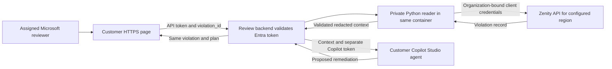

# How the remediation assistant works

The assistant retrieves a live AISPM violation from Zenity, passes its redacted details to Copilot Studio, and displays a proposed remediation plan. The review backend performs lookup before invoking the agent. It applies no changes to the affected resource or violation status.

## Architecture

The customer container hosts the page, JWT-authenticated backend and private Python reader. The backend checks the API token's signature, expiry, issuer, tenant, audience, SPA caller, delegated scope and reviewer role before retrieval. See [the customer runtime guide](deploy/customer/README.md).

The internal Corpo Valley deployment uses its hosting gateway for reviewer authorization and calls a private lookup service over loopback within the same pod. It does not call the Azure lookup test host. Internal deployment and customer source changes require separate builds and rollout.

## What happens during a review

1. **Select a violation.** Open an AISPM violation in Zenity and copy the ID from the top of its details. The input is a violation ID. AIDR runtime findings use a separate record/API contract. The `findings` array inside a violation contains supporting evidence for that violation.
2. **Authenticate.** The customer page is public; authenticated API access authorizes a review. Microsoft sign-in obtains a delegated Power Platform token to invoke the configured agent. In the internal demo, these are separate identity boundaries: Corpo Valley project access and Microsoft agent access. In a customer deployment the browser obtains distinct API and Copilot access tokens from the configured customer Microsoft tenant.
3. **Submit the ID.** The browser sends `POST /plan` on the page's origin, with exactly `{"violation_id":"..."}`. Customer requests carry the review API token in `Authorization` and the separate Copilot token in `X-Copilot-Authorization`. The backend checks reviewer authorization, same-origin submission, JSON type and input shape. The browser cannot supply source context or choose an organization, integration or agent.
4. **Retrieve the record.** The customer backend starts its private Python reader as a child process. The internal demo uses a private HTTP lookup service. The reader obtains an organization-bound Zenity token and reads `GET /v1/assessment/integrations/{configured_integration}/violations/{violation_id}` on the configured regional API host.
5. **Validate and project.** The reader checks organization, integration, requested record ID and required fields. It projects bounded rule descriptions, risk, triage and fix suggestions, plus selected evidence. It removes recognized credentials and emails and retains URL origins while omitting paths and queries.
6. **Ask Copilot to plan.** The backend starts a new conversation with the configured published agent and serializes the retrieved context into the message. Instructions require the agent to treat source text as data and cite the supplied violation ID, rule ID and observation time. The agent needs no lookup tool or lookup connection.
7. **Display the result.** The backend returns the same retrieved violation alongside Copilot's messages. The page labels retrieved text as Zenity rule guidance and displays the agent's proposed remediation separately. Text-node rendering prevents source text becoming executable markup.

## Components

| Responsibility | Source |
| --- | --- |
| Customer page | [index.html](deploy/customer/public/index.html) |
| Shared browser sign-in, request and rendering | [app-entry.js](copilot/web/app-entry.js) |
| Customer reviewer/request validation and `/plan` | [server.mjs](deploy/customer/server.mjs), [auth.mjs](deploy/customer/auth.mjs) |
| Fixed customer settings and public configuration | [config.mjs](deploy/customer/config.mjs) |
| Private customer reader process | [lookup.mjs](deploy/customer/lookup.mjs), [lookup.py](deploy/customer/lookup.py) |
| Zenity authentication and scoped retrieval | [zenity_auth.py](zenity_auth.py), [zenity_reader.py](zenity_reader.py) |
| Evidence projection and action validation | [evidence.py](evidence.py), [engine.py](engine.py) |
| Shared agent invocation | [client.js](copilot/web/client.js) |
| Agent behavior | [agent-instructions.md](copilot/agent-instructions.md) |
| Internal gateway and lookup transport | [internal deployment](deploy/corpo-valley/README.md) |

The customer Dockerfile builds the browser bundle from shared source. The internal deployment builds and copies its own bundle and agent adapter separately.

## Configuration and credentials

| Value | Location and use |
| --- | --- |
| Organization, integration and region endpoints | Fixed lookup deployment configuration |
| Zenity client ID and secret | Lookup host secret store; used for token exchange |
| Zenity bearer token | Lookup process memory; used only for Zenity retrieval |
| Tenant, SPA/API client, environment and agent schema IDs | Server-mounted `app.json`; fixed for the deployment |
| Public browser configuration | `agent-config.json` exposes only tenant ID, SPA client ID and review API scope |
| Microsoft delegated tokens | MSAL session cache and review request; API token authorizes the backend, separate Copilot token invokes the agent |
| Hosting reviewer identity | Internal demo: hosting boundary. Customer runtime: cryptographically validated Entra API token before lookup |
| Rule and selected evidence | Redacted server-side, then included in the Copilot message and page response |

Both Microsoft tokens are absent from the source context sent to the model. Zenity credentials stay server-side in the private reader. The application implements no persistent review history; Microsoft platform conversation retention is governed by the target environment's configuration.

## Failure handling

| Failure | Behavior |
| --- | --- |
| Missing reviewer access, cross-site submission or malformed request | Reject before lookup |
| Unknown, denied, mismatched or unavailable violation | Report a lookup error; do not invoke Copilot |
| Expired Microsoft token | Browser attempts silent renewal, then redirects for authentication when required |
| Copilot failure after successful lookup | Return the retrieved violation with a planning error |
| Request to apply remediation | Agent explains manual steps; the application has no remediation operation |

The action has a 10-second lookup budget with at most one transient retry. The customer reader child process has an 11-second timeout. The internal demo additionally has a 13-second backend lookup HTTP timeout. Planning has a 150-second response deadline. These are configured limits, rather than measured performance guarantees. A planning timeout does not guarantee cancellation of a conversation already accepted by Microsoft.

## Named invariants

1. **FixedScope**: user input cannot select credentials, organization, integration or API host.
2. **ServerSource**: the backend obtains the violation context and rejects browser-supplied context.
3. **SameViolation**: displayed evidence and the agent prompt use the same retrieved record.
4. **SourceAsData**: rule and evidence text cannot authorize tools, disclose credentials or change instructions.
5. **ReadOnly**: review produces guidance and performs no resource or status mutation.
6. **ReviewerAccess**: host authorization precedes lookup; agent invocation uses the Microsoft reviewer's token.

## Current limits and validation

Each lookup deployment supports one configured integration. Multi-integration resolution is unimplemented. The scope is AISPM violations, and the architecture can carry rules and evidence for different platforms. The customer reader preserves the API resource type across platforms. Platform-specific guidance still requires live acceptance before it is claimed as working.

Evidence projection retains six rule text fields, at most five evidence entries, and selected text and URL origins. Some violations may need fields this projection omits. Redaction recognizes specific patterns and requires review against your data policy. Copilot can still generate inaccurate instructions. In the internal test it suggested a generic compliance scan that had no verified source.

The internal demo has produced a plan grounded in a real EU violation's disallowed HTTP endpoint. The portable customer image and generated bundle have passed build, startup and authorization checks. See [validation results](docs/customer-runtime-validation.md). Live target-tenant acceptance is still required.

## Numbered milestones and published test vectors

1. **Internal end-to-end review:** retrieve a live record and display a plan using the same source context. See CT01-06 in [the direct-context contract](docs/copilot-web-spec.md).
2. **Customer hosting:** configure customer-owned IDs and secrets, and deploy the portable application container. See [the deployment guide](docs/customer-deployment-spec.md).
3. **Customer acceptance:** run CD01-12 in the target environment, including reviewer denial, credential renewal, different resource types, cold-start timing and zero resource changes. Record source revision, image digests, agent version and results.
